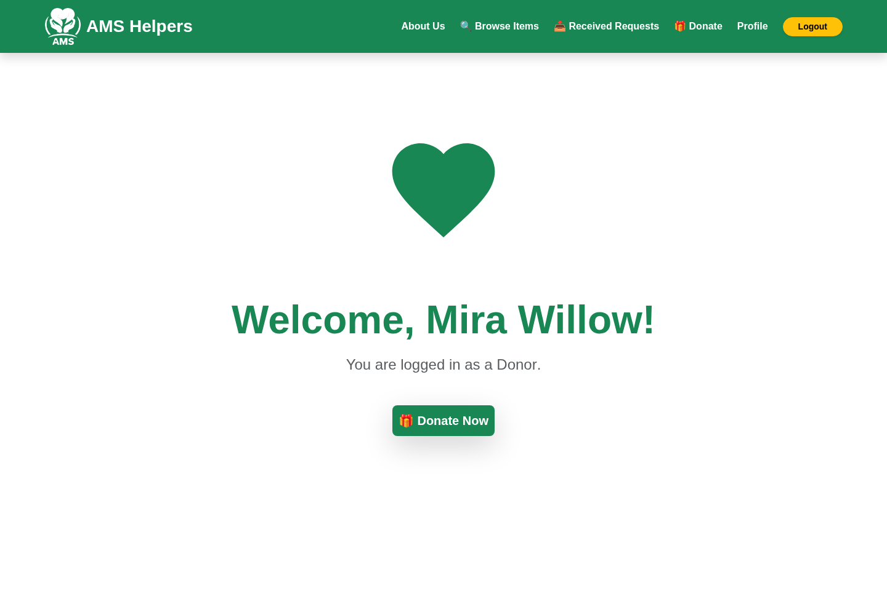
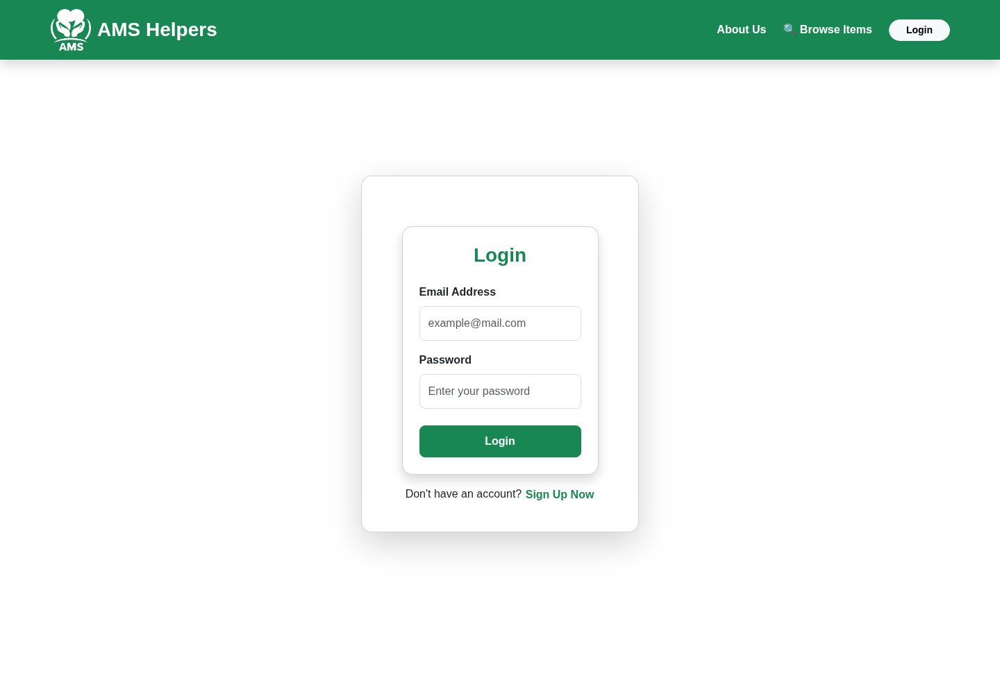
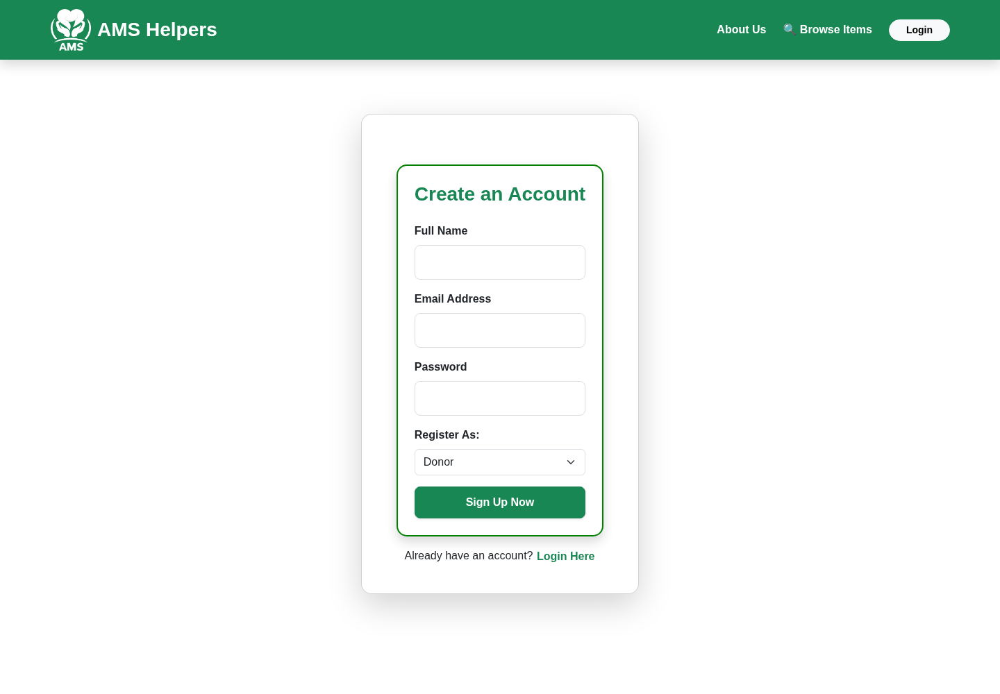
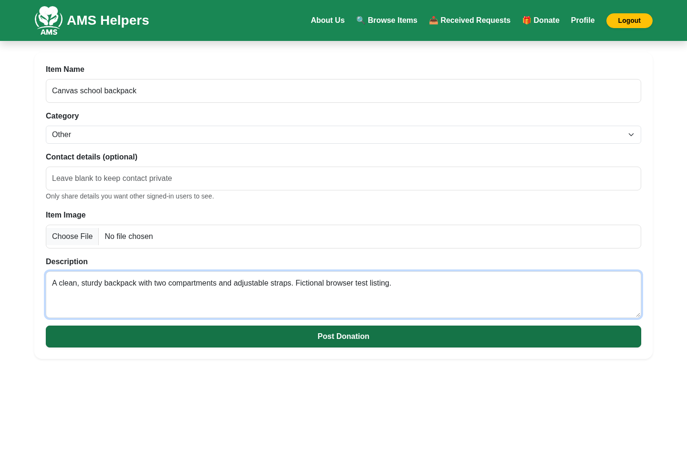
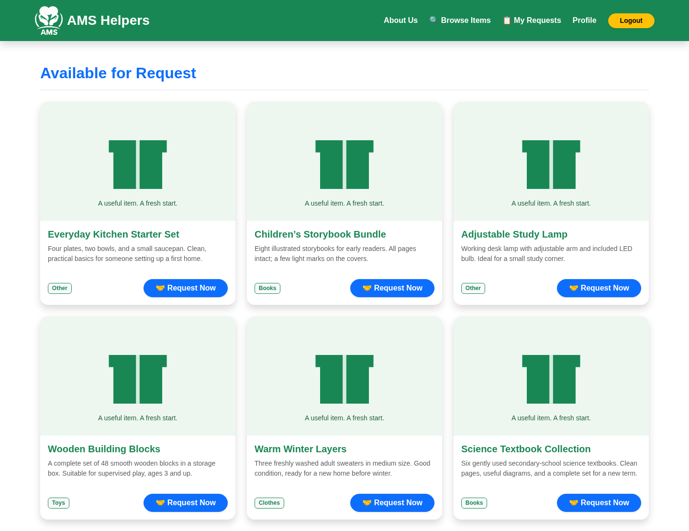
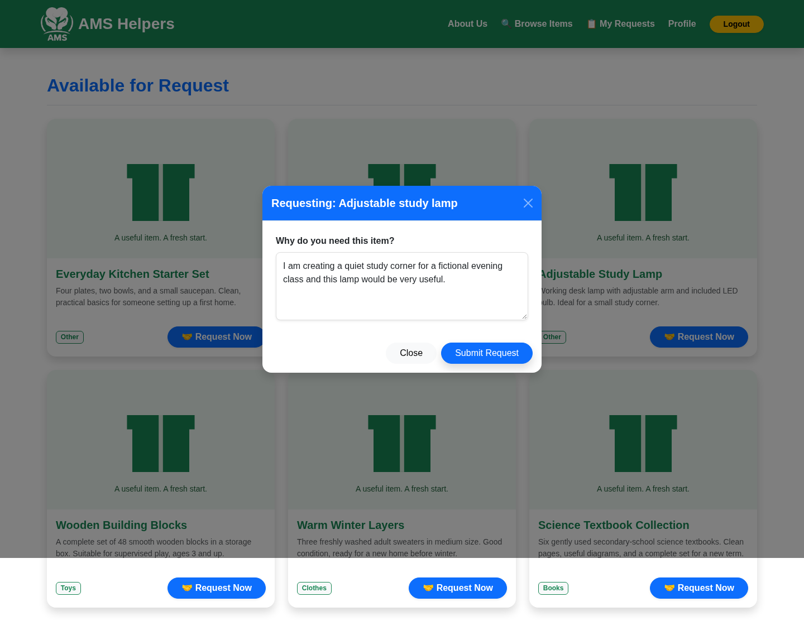
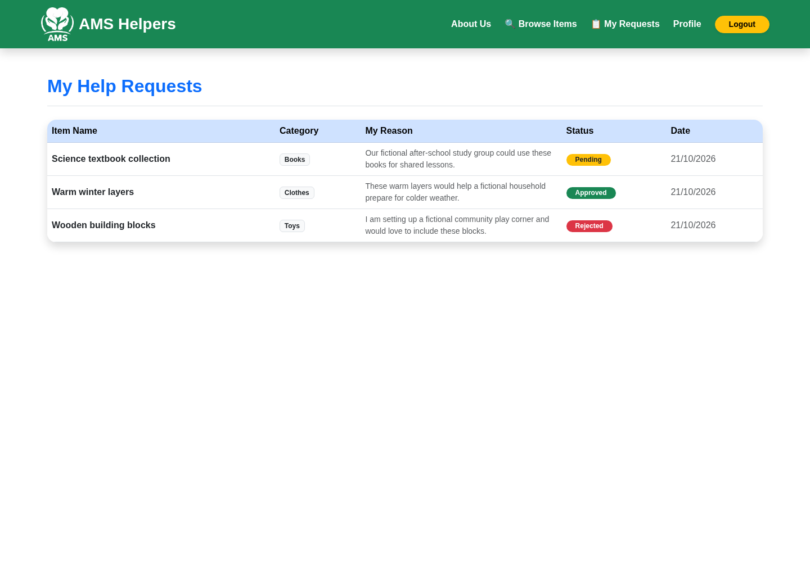
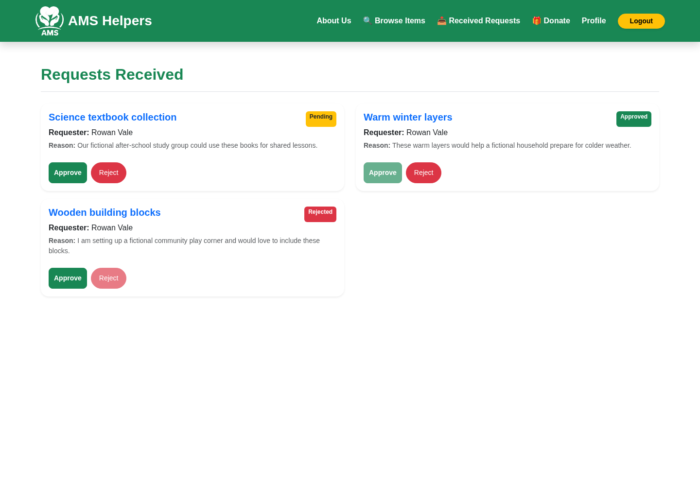
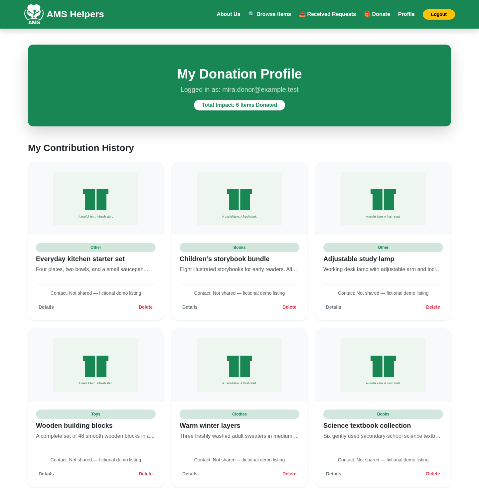

# Community Donation Platform 🤝

### Connecting people who have items to give with people who need them

**Community Donation Platform** is a full-stack web application for sharing reusable items within a community. Donors can post available items, and requesters can browse listings and submit requests for the things they need.

Built with **React, Node.js, Express, and MongoDB**.

---

## ✨ Features

- **Donor and requester accounts** — Register and sign in with a selected account role.
- **Donation listings** — Post items with a title, description, category, contact number, and optional image.
- **Browse available items** — Explore donation cards with images and item details.
- **Request an item** — Submit a request with a short explanation of why the item is needed.
- **Track requests** — Review submitted requests and their pending, approved, or rejected status.
- **Donor views** — See donations associated with your account and requests received for donated items.
- **Request status management** — Backend endpoints support approving or rejecting requests.
- **Responsive interface** — React components with Bootstrap-based styling.

## 🛠 Tech stack

| Layer | Technologies |
| --- | --- |
| Frontend | React, React Router, Axios |
| Backend | Node.js, Express |
| Database | MongoDB, Mongoose |
| Authentication | JWT, bcryptjs |
| Image uploads | Multer |
| Styling | CSS, Bootstrap-based UI |

## 🔄 How it works

1. **Sign up** as a Donor or Requester.
2. **Donors** post available items, including an item description and image.
3. **Requesters** browse donated items and submit requests.
4. **Donors** review incoming requests and their statuses.
5. **Requesters** follow the progress of their submitted requests.

## 📸 Application gallery

Captured from the running React application with Express and MongoDB, using fictional demo accounts and persisted listings/requests. Click an image to view it at full size.

| Home | Login | Registration |
| --- | --- | --- |
| [](docs/screenshots/home.png) | [](docs/screenshots/login.png) | [](docs/screenshots/registration.png) |

| Post a donation | Browse available items | Submit a request |
| --- | --- | --- |
| [](docs/screenshots/donation-form.png) | [](docs/screenshots/available-items.png) | [](docs/screenshots/request-submission.png) |

| My Requests | Donor request management | Donor profile |
| --- | --- | --- |
| [](docs/screenshots/my-requests.png) | [](docs/screenshots/donor-requests.png) | [](docs/screenshots/donor-profile.png) |

See [test and capture instructions](docs/TESTING.md) and the [capture manifest](docs/screenshots/capture-manifest.json).

## 🚀 Getting started

### Prerequisites

- Node.js 24 and npm 11 (validated locally)
- MongoDB 8, or Docker for the official local database container
- Chromium for the browser checks and screenshot capture

### 1. Clone the repository

```bash
git clone https://github.com/aymenmansoor/Community-Donation-Platform.git
cd Community-Donation-Platform
```

### 2. Install dependencies and start MongoDB

```bash
npm ci
(cd backend && npm ci)
(cd frontend && npm ci)
docker run -d --name community-donation-mongo \
  -p 127.0.0.1:27017:27017 \
  -v community-donation-mongo-data:/data/db \
  mongo@sha256:4b58ebcb1dc7a7b4e84cd8ce9098d48764ae4478876898ff9551acf2ac4a6a6d --bind_ip_all
```

For an existing container, use `docker start community-donation-mongo`. This loopback-only, isolated development database has no authentication; use the authenticated configuration in [deployment preparation](docs/DEPLOYMENT.md) before public hosting.

### 3. Configure and start the backend

```bash
cd backend
```

Create a `backend/.env` file containing values for your own environment:

```dotenv
MONGO_URI=mongodb://127.0.0.1:27017/community_donation
JWT_SECRET=<generate-a-private-random-value-of-at-least-32-characters>
PORT=5000
```

Start the backend:

```bash
node server.js
```

The API runs at `http://localhost:5000` by default.

### 4. Start the frontend

Open another terminal from the repository root:

```bash
cd frontend
npm start
```

Open `http://localhost:3000` in your browser.

The frontend defaults to the local backend on port 5000. `REACT_APP_API_URL` selects a different backend at build time; an explicitly empty value uses the current origin. Bootstrap CSS and modal JavaScript are bundled locally.

### 5. Seed and validate

Use the private seed-password instructions in [docs/TESTING.md](docs/TESTING.md), then run:

```bash
npm test --prefix backend
CI=true npm test --prefix frontend -- --watchAll=false --runInBand
CI=true npm run build --prefix frontend
```

API access requires a valid signed-in session. Donors manage only their own listings and requests; requesters see their own request history. The API health endpoint reports actual database connectivity.

### Hosting status

Public hosting has **not** been launched. Dockerfiles, a same-origin Nginx gateway, authenticated MongoDB configuration and persistent storage are prepared in `compose.demo.yaml`. Read [docs/DEPLOYMENT.md](docs/DEPLOYMENT.md) for the security review, private environment variables, local rehearsal and remaining launch approvals.

## 📁 Project structure

```text
Community-Donation-Platform/
├── backend/
│   ├── models/          MongoDB models for users, donations, and requests
│   ├── routes/          Request API routes
│   ├── uploads/         Locally stored uploaded item images
│   └── server.js        Express API and MongoDB connection
├── frontend/
│   ├── public/          Frontend public assets
│   └── src/
│       ├── components/  Forms, navigation, authentication, and profile views
│       └── pages/       Item browsing and request-management views
├── index.html
├── style.css
└── README.md
```

## 🧩 Application modules

**Frontend:** Role-aware navigation, account registration and sign-in, donation creation, available-item browsing, profiles, and request tracking.

**Backend:** Express REST endpoints for authentication, donations, item retrieval, and donation requests, backed by MongoDB.

---

*Community Donation Platform is a web development project focused on making item donation and community sharing more accessible.*
