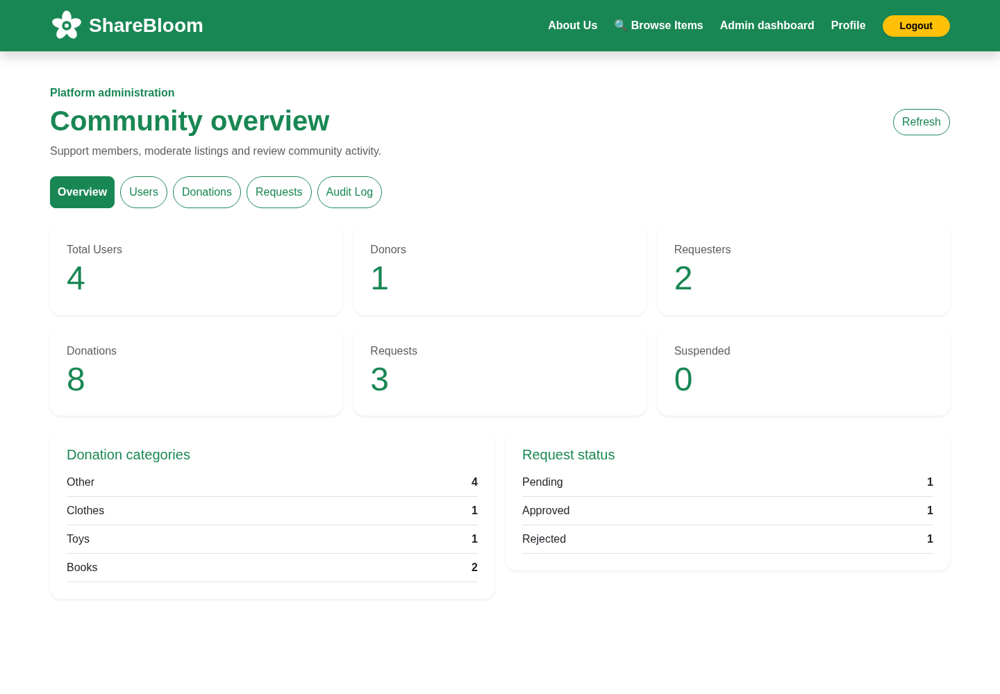
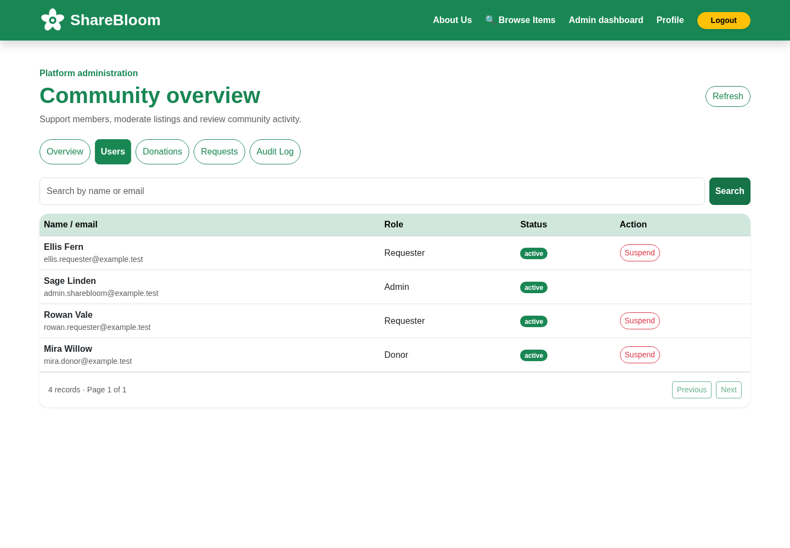
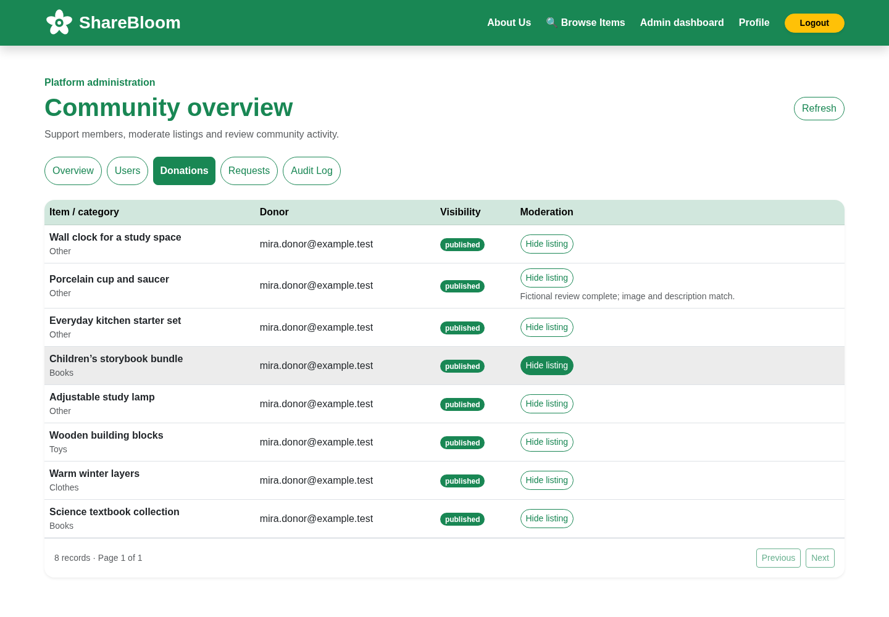
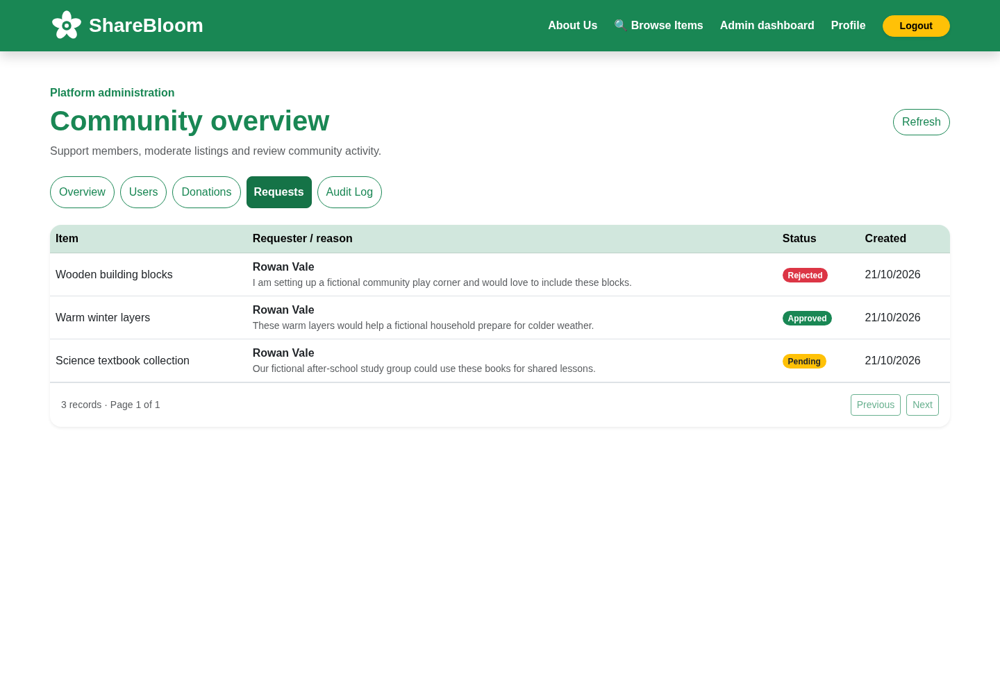
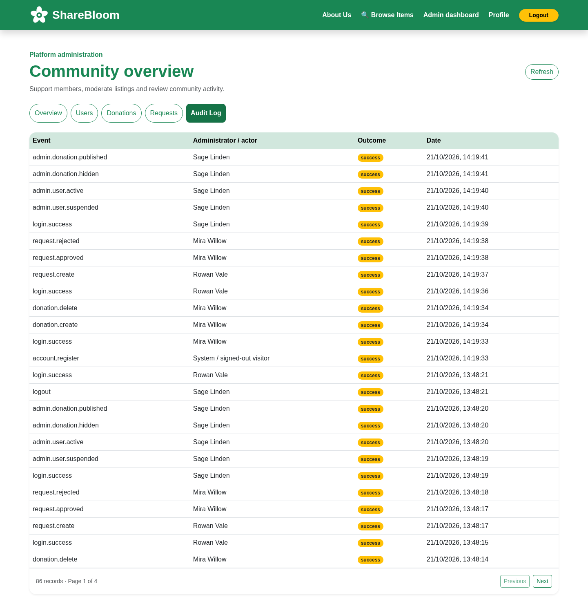
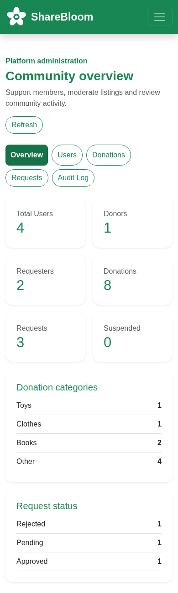

# ShareBloom 🌱

**Share kindness. Give items a new beginning.**

ShareBloom is a React, Express and MongoDB platform for sharing useful items within a community. Donors post listings, requesters explain how an item would help them, and administrators support the community through moderation and account management.

The existing green-and-white Bootstrap design is shared across donor, requester and administrator screens. The GitHub repository name remains `Community-Donation-Platform`.

## Features

- **Donors:** create listings with a photograph preview, review their contribution history, delete their own items, and approve or reject requests for their own donations.
- **Requesters:** browse available items, submit a reason, and follow their own pending, approved and rejected requests.
- **Administrators:** view statistics and categories, search users, suspend/reactivate accounts, hide/restore listings with a reason, review requests, and inspect audit events.
- **Sessions:** HttpOnly cookies, CSRF protection, one-hour JWT expiry, server-side revocation and immediate suspension enforcement.
- **Photos:** JPEG/PNG/WebP uploads up to 5 MiB, validated by a real decoder, resized and re-encoded as metadata-free WebP. Existing uploaded images remain supported.
- **Responsive UI:** consistent green navigation, light backgrounds, rounded cards and status badges on desktop and mobile.

## Application gallery

These screenshots were captured from the actual running React application, Express API and MongoDB. All displayed people, accounts and scenarios are fictional. No API responses were mocked for the browser captures.

| Donor home | Login | Registration |
| --- | --- | --- |
| [](docs/screenshots/home.png) | [](docs/screenshots/login.png) | [](docs/screenshots/registration.png) |

| Donation and photo preview | Available items | Request submission |
| --- | --- | --- |
| [](docs/screenshots/donation-form.png) | [](docs/screenshots/available-items.png) | [](docs/screenshots/request-submission.png) |

| Student-style request history | Donor decisions | Donor profile |
| --- | --- | --- |
| [](docs/screenshots/my-requests.png) | [](docs/screenshots/donor-requests.png) | [](docs/screenshots/donor-profile.png) |

| Administration overview | User management | Donation moderation |
| --- | --- | --- |
| [](docs/screenshots/admin-overview.png) | [](docs/screenshots/admin-users.png) | [](docs/screenshots/admin-donations.png) |

| Request oversight | Audit trail | Mobile views |
| --- | --- | --- |
| [](docs/screenshots/admin-requests.png) | [](docs/screenshots/admin-audit.png) | [](docs/screenshots/admin-mobile.png) · [Requester on mobile](docs/screenshots/requester-mobile.png) |

[Capture manifest and image hashes](docs/screenshots/capture-manifest.json) · [Photograph licences and provenance](backend/fixtures/photos/ATTRIBUTION.md)

## Technology

| Layer | Tools |
| --- | --- |
| Interface | React 19, React Router 7, Bootstrap 5, Axios |
| API | Node.js 24, Express 5, Mongoose |
| Database | MongoDB 8 |
| Security | bcrypt, HS256 JWTs, revocable sessions, CSRF tokens, Helmet, rate limits |
| Images | Multer limits, Sharp decoding/re-encoding |
| Tests | Node test runner, Vitest/React Testing Library, Playwright/Chromium |
| Hosting preparation | Docker Compose, Nginx, private authenticated MongoDB, persistent volumes |

## Run locally

Requirements: Node 24, npm 11, Docker, and Chromium for browser checks. Use the existing checkout in cloud tasks; no additional worktree is needed.

```bash
# Stop application processes before refreshing node_modules.
npm ci
npm ci --prefix backend
npm ci --prefix frontend

docker run -d --name community-donation-mongo \
  -p 127.0.0.1:27017:27017 \
  -v community-donation-mongo-data:/data/db \
  mongo@sha256:4b58ebcb1dc7a7b4e84cd8ce9098d48764ae4478876898ff9551acf2ac4a6a6d --bind_ip_all
```

Use `docker start community-donation-mongo` if that container already exists. This unauthenticated development database must remain bound to loopback. Public hosting requires the authenticated configuration and transport review in [deployment preparation](docs/DEPLOYMENT.md).

Copy `backend/.env.example` to a private `backend/.env`, generate your own random JWT secret of at least 32 bytes, and configure the MongoDB URI and exact frontend origins. Never commit real values. Start each service in its own terminal:

```bash
cd backend
npm start
```

```bash
cd frontend
BROWSER=none npm start
```

The local ports are 3000 (React) and 5000 (Express). `GET /api/health` reports actual database connectivity. `REACT_APP_API_URL` chooses the backend at build time; an explicitly empty value uses same-origin requests through Nginx. For cookie sessions, use consistent hostnames locally, and same-site HTTPS frontend/API origins in production. See [authentication and RBAC](docs/SECURITY.md).

In the prepared cloud workspace, `scripts/setup-local.sh` installs locked dependencies and creates private configuration outside the repository without overwriting existing values. See [testing and fictional fixtures](docs/TESTING.md) for seed and browser commands.

## Provision the first administrator

Set `MONGO_URI`, `ADMIN_EMAIL`, `ADMIN_NAME` and a private `ADMIN_PASSWORD` in a secure file outside the checkout, then run:

```bash
node --env-file=/absolute/private/admin.env backend/scripts/provision-admin.js
```

There are no default admin credentials. The command refuses to promote an existing ordinary user or run when any administrator already exists. Public registration accepts only Donor and Requester. Administrators cannot change roles or suspend administrator accounts through the dashboard.

## Validation

```bash
npm test --prefix backend
npm test --prefix frontend
npm run build --prefix frontend
```

The latest run passed **18 backend tests, 10 frontend tests and nine real browser scenarios**, and the production build. Sixteen genuine screenshots are recorded in the capture manifest. See the [validation record](docs/VALIDATION.md) for evidence and limitations. Passing tests do not guarantee security.

## Hosting status and remaining work

No public demo has been deployed and no public URL is advertised. Dockerfiles, a same-origin Nginx gateway, authenticated private MongoDB and persistent upload volumes are prepared and tested locally. Public deployment and paid resources require owner approval.

All eight fictional listings now have relevant licensed photographs: six Pexels photographs and two CC0/public-domain sources. Photos are representative illustrations; see the attribution record for visible contents and quantity/condition limitations. Donation IDs, descriptions, requests and genuine uploads were preserved. The gallery was recaptured from the running application.

The recorded frontend and backend dependency audits report zero known vulnerabilities. Retired React Scripts/Jest tooling was replaced with Vite/Vitest while preserving the React UI and test assertions. A clean audit is not a security guarantee; provider configuration and abuse controls still need launch review. See [security notes](docs/SECURITY.md) and [deployment preparation](docs/DEPLOYMENT.md).

For the proposed single-server hosting budget and approval-gated launch sequence, see [the deployment plan](docs/DEPLOYMENT-PLAN.md).
