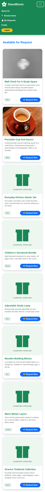

# ShareBloom 🌱

**Share kindness. Give items a new beginning.**

ShareBloom helps communities give useful items a second life. Donors share what they no longer need, requesters explain how an item would help them, and administrators keep the community organised through moderation and account management.

Built with React, Express and MongoDB, with a responsive green-and-white interface. This is a completed GitHub portfolio project intended to run locally; there is no public deployment.

## Features

- **Donors:** publish listings with photographs, manage their donations, and approve or reject requests for their own items.
- **Requesters:** browse available items, submit requests, and track pending, approved and rejected decisions.
- **Admins:** review statistics, search and manage accounts, moderate listings, oversee requests, and inspect audit events.
- **Across the application:** responsive desktop/mobile navigation, role-based access, protected sessions and validated image uploads.

## Application screenshots

All 16 screenshots are genuine captures of the running application with fictional demo accounts and data. Click any image to view it at full resolution. Expand a workflow to explore its screens.

### Home

[](docs/screenshots/home.png)

<details>
<summary><strong>Login and registration</strong></summary>

**Login**

[](docs/screenshots/login.png)

**Registration**

[](docs/screenshots/registration.png)

</details>

<details>
<summary><strong>Donor workflow</strong></summary>

**Donation form and photo preview**

[](docs/screenshots/donation-form.png)

**Donor request management**

[](docs/screenshots/donor-requests.png)

**Donor profile and contribution history**

[](docs/screenshots/donor-profile.png)

</details>

<details>
<summary><strong>Requester workflow</strong></summary>

**Available donation items**

[](docs/screenshots/available-items.png)

**Request submission**

[](docs/screenshots/request-submission.png)

**My Requests**

[](docs/screenshots/my-requests.png)

</details>

<details>
<summary><strong>Admin dashboard</strong></summary>

**Statistics and overview**

[](docs/screenshots/admin-overview.png)

**User management**

[](docs/screenshots/admin-users.png)

**Donation moderation**

[](docs/screenshots/admin-donations.png)

**Request oversight**

[](docs/screenshots/admin-requests.png)

**Audit trail**

[](docs/screenshots/admin-audit.png)

</details>

<details>
<summary><strong>Mobile views</strong></summary>

**Admin on mobile**

<a href="docs/screenshots/admin-mobile.png"></a>

**Requester on mobile**

<a href="docs/screenshots/requester-mobile.png"></a>

</details>

## Technology stack

- **Frontend:** React 19, React Router 7, Bootstrap 5, Axios and Vite.
- **Backend:** Node.js 24, Express 5, Mongoose, Multer and Sharp.
- **Database:** MongoDB 8.
- **Testing:** Node test runner, Vitest, React Testing Library and Playwright/Chromium.

## Run locally

Install Node.js 24, npm 11 and Docker, then clone the repository:

```bash
git clone https://github.com/aymenmansoor/Community-Donation-Platform.git
cd Community-Donation-Platform
npm ci
npm ci --prefix backend
npm ci --prefix frontend
```

Start a local MongoDB instance with persistent storage:

```bash
docker run -d --name community-donation-mongo \
  -p 127.0.0.1:27017:27017 \
  -v community-donation-mongo-data:/data/db \
  mongo@sha256:4b58ebcb1dc7a7b4e84cd8ce9098d48764ae4478876898ff9551acf2ac4a6a6d --bind_ip_all
```

If the container already exists, use `docker start community-donation-mongo`. Keep this development database bound to loopback.

Copy `backend/.env.example` to `backend/.env`. Set `JWT_SECRET` to a private random value of at least 32 characters (for example, generate one with `openssl rand -hex 32`). Keep the supplied local MongoDB URI and frontend origins. Never commit real credentials.

Start the backend and frontend in separate terminals:

```bash
cd backend
npm start
```

```bash
cd frontend
npm start
```

Open **http://localhost:3000**. The API runs at **http://localhost:5000**; `/api/health` checks database connectivity. Use `localhost` consistently for browser sessions. Register as a Donor or Requester to explore the application.

For fictional sample data, browser checks and private first-admin provisioning, see [the local testing guide](docs/TESTING.md). There are no default admin credentials.

## Verification and documentation

The last application verification passed **18 backend tests, 10 frontend tests, nine real browser scenarios**, and the production build.

```bash
npm test --prefix backend
npm test --prefix frontend
npm run build --prefix frontend
```

Backend tests require the local MongoDB instance. Detailed checks and limitations are recorded in [validation](docs/VALIDATION.md).

- [Local testing and demo fixtures](docs/TESTING.md)
- [Security and access control](docs/SECURITY.md)
- [Project handover](docs/HANDOVER.md)

ShareBloom is complete as a GitHub portfolio project. Public deployment is not planned.
